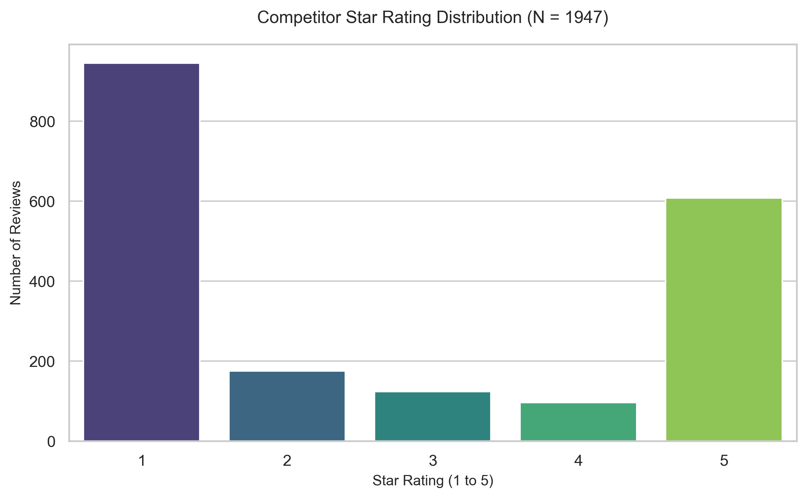
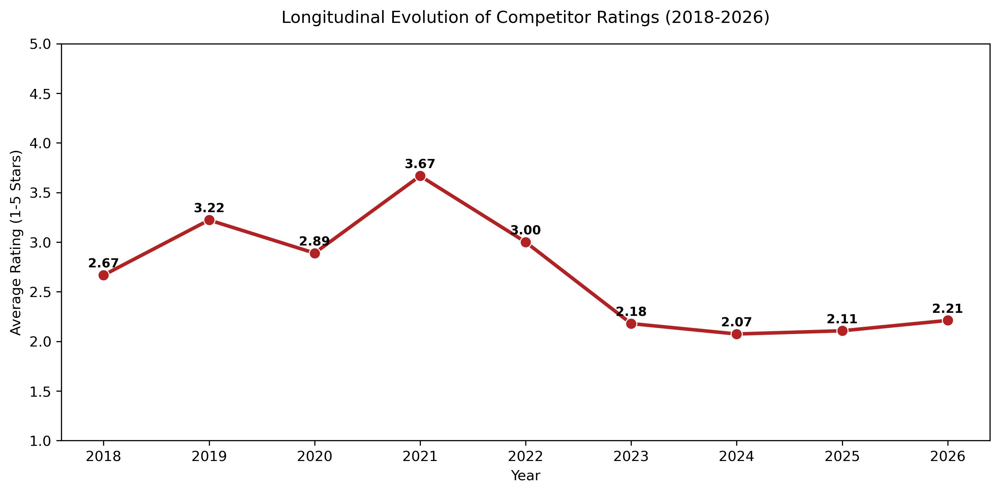
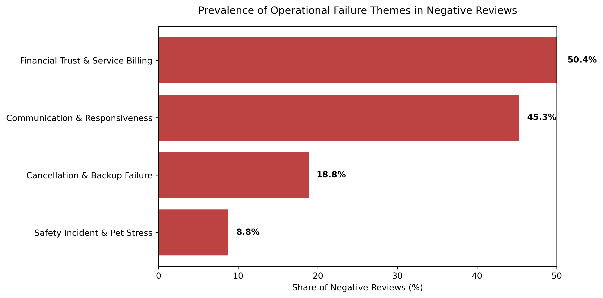
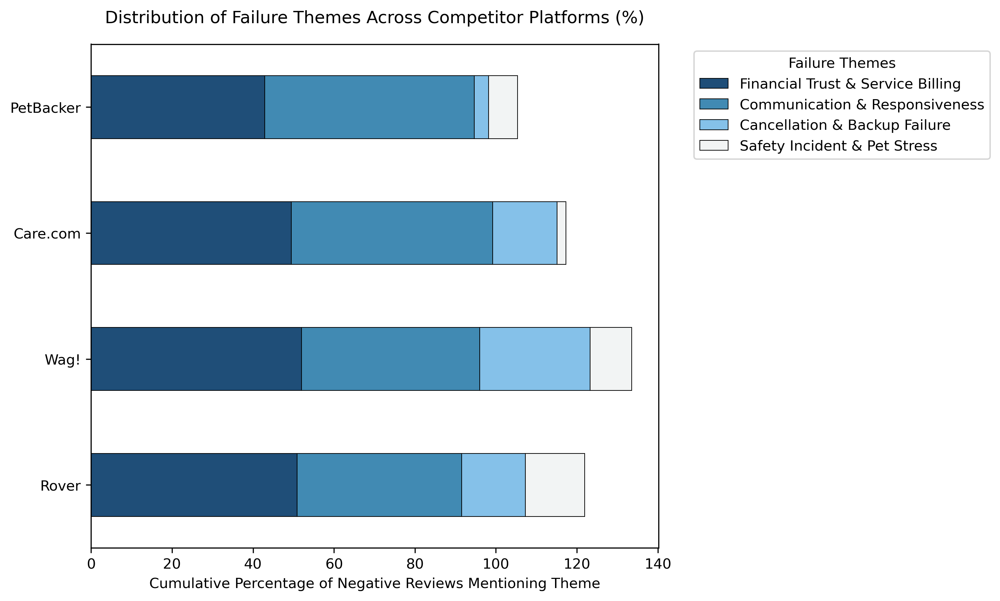
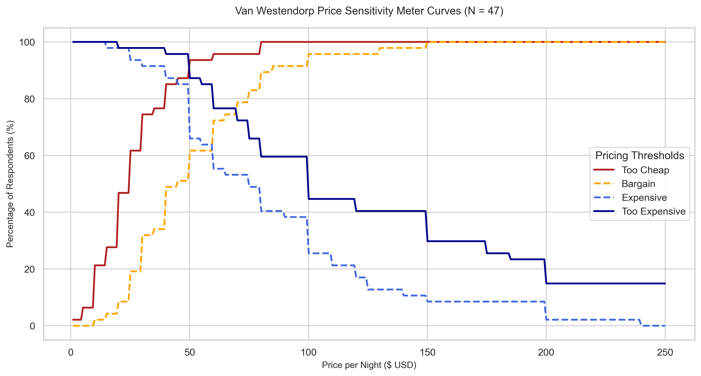
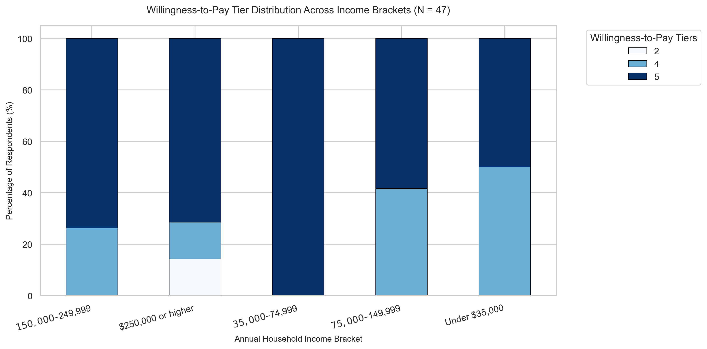

# Zoélys Master's Thesis: Empirical Research & Data Analysis

This repository houses the complete code-driven analysis pipeline, review-mining diagnostics, and survey insights supporting the Zoélys Master's thesis (N = 1,947 competitor reviews and N = 47 primary survey responses).

---

## Empirical Data & Visualizations

### 1. Competitor Star Rating Distribution

### 2. Longitudinal Evolution of Competitor Ratings (2018–2026)

### 3. Operational Failure Themes in Negative Reviews

### 4. Cross-Platform Failure Theme Breakdown

### 5. Van Westendorp Price Sensitivity Meter (N = 47)

### 6. Willingness-to-Pay Across Income Brackets (N = 47)

---

## Repository Structure
* `scripts/`: Modular Python scripts used to generate each chart programmatically from source datasets.
* `docs/` & `src/`: Core thesis documentation and architecture files.
